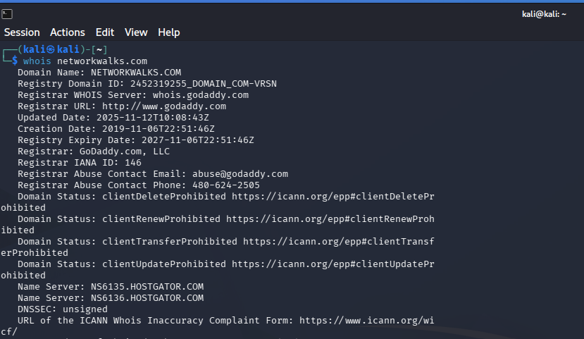
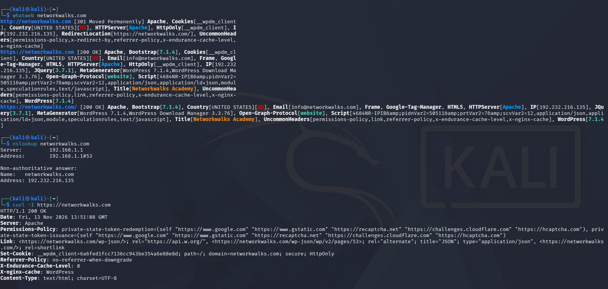
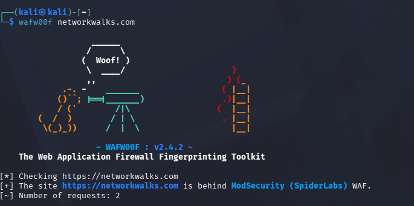
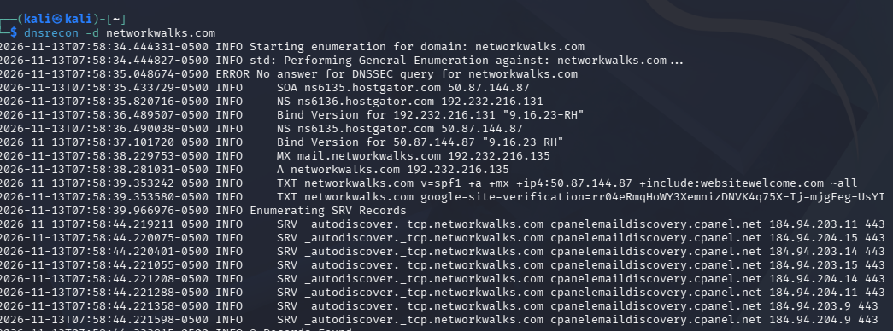
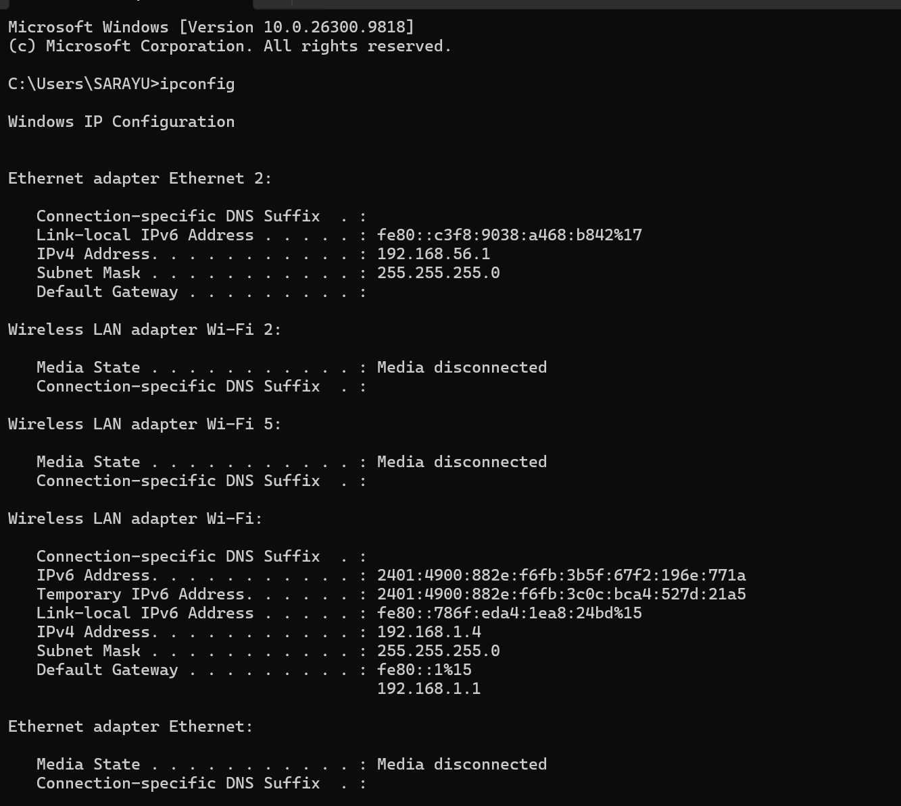
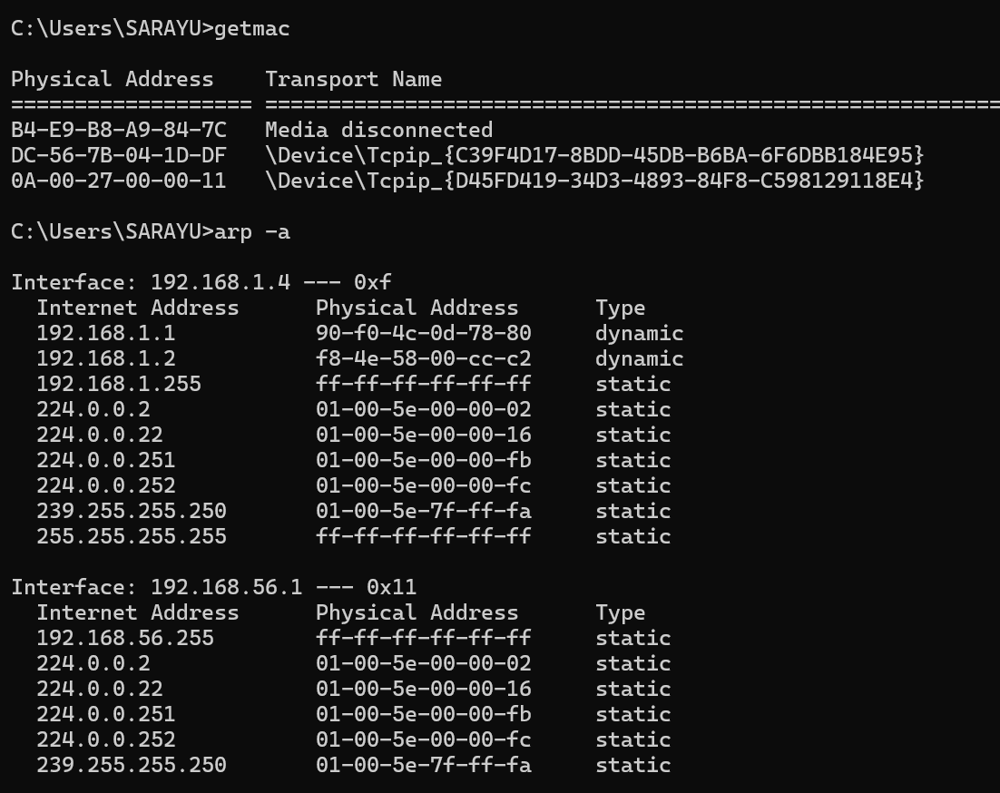
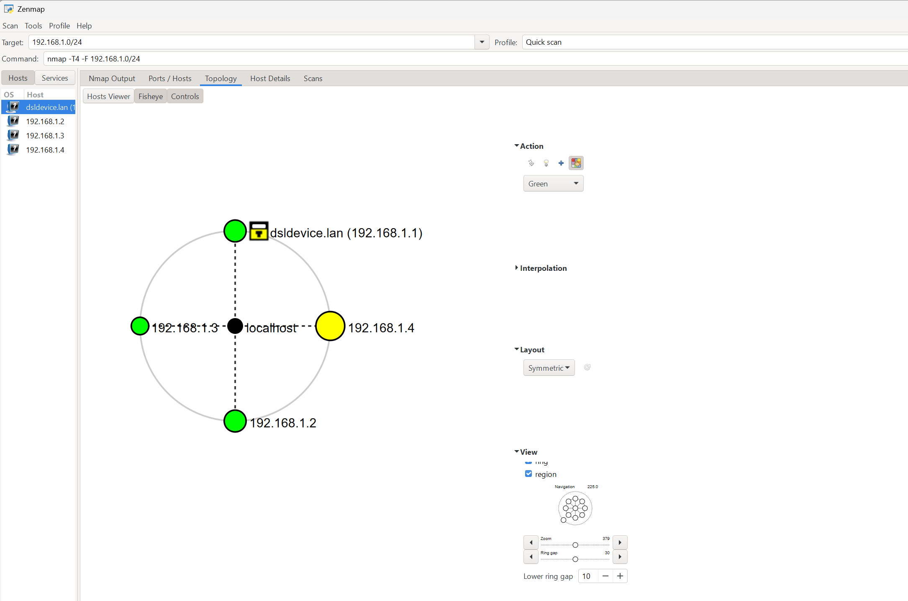

# NETWORKWALKS-BO84-WK2-CYBERSECURITY-LAB-SETUP-
Week 2 penetration testing report for the Networkwalks Cybersecurity internship (Batch B084): footprinting networkwalks.com with six Kali tools (WHOIS, WhatWeb, Nslookup, Curl, Wafw00f, DNSRecon) and scanning my own LAN with Zenmap. Educational use only.

# Penetration Testing Report: Footprinting & Network Scanning (Week 2)

**W2-PM-FINAL | Cybersecurity & Ethical Hacking Internship | Networkwalks**

  

---

## 1. Liability Disclaimer

All activities in this report were performed only on systems where I had written permission, or on devices and networks that I own. This material is for education and research only. Do not use anything here to break the law. Unauthorised access is a crime in most countries, even when nothing is damaged. The instructor, the authors and Networkwalks are not responsible for how this knowledge is used.

---

## 2. Introduction

This report covers two modules from Week 2 of the Networkwalks Cybersecurity internship:

- **W2-PM1:** footprinting the `networkwalks.com` domain with six Kali Linux tools.
- **W2-PM5:** scanning my own local network with Zenmap.

Together they show how an attacker moves from collecting public information to mapping live hosts on a network. No exploitation, brute-forcing or denial-of-service was performed.

---

## 3. Tools Used

| Tool | Purpose |
|---|---|
| Kali Linux / Windows | Operating systems used for the activities |
| `whois` | Domain registration details (registrar, dates, name servers) |
| `whatweb` | Fingerprint web technologies (server, CMS, plugins, IP) |
| `nslookup` | Resolve the domain name to an IP address |
| `curl -I` | Read the HTTP response headers |
| `wafw00f` | Detect whether a Web Application Firewall is present |
| `dnsrecon` | Enumerate DNS records (NS, MX, TXT, SRV) |
| Zenmap (Nmap GUI) | Discover live hosts on the local subnet |
| Windows CMD (`ipconfig`, `arp -a`) | Identify local IP, MAC and neighbouring devices |

---

## 4. Activities Performed

### 4.1 Footprinting & Reconnaissance (W2-PM1)

Target: `networkwalks.com` only.

#### 4.1.1 WHOIS

**Command:** `whois networkwalks.com`

**Observation:** <!-- Write what YOUR output showed: registrar, creation/expiry dates, name servers, privacy protection -->

  

#### 4.1.2 WhatWeb

**Command:** `whatweb networkwalks.com`

**Observation:** <!-- Write the web server, CMS, plugins and IP your output showed -->

  

#### 4.1.3 Nslookup

**Command:** `nslookup networkwalks.com`

**Observation:** <!-- Write the IP address your output showed -->

#### 4.1.4 Curl (HTTP headers)

**Command:** `curl -I https://networkwalks.com`

**Observation:** <!-- Write the server header, redirects and any exposed endpoints -->

 

#### 4.1.5 Wafw00f

**Command:** `wafw00f networkwalks.com`

**Observation:** <!-- Write whether a WAF was detected and which one -->

  

#### 4.1.6 DNSRecon

**Command:** `dnsrecon -d networkwalks.com`

**Observation:** <!-- Write the name servers, mail servers and TXT/SPF records found -->

  

---

### 4.2 Network Scanning with Zenmap (W2-PM5)

Target: my own local network only.

#### 4.2.1 Identify my IP and subnet

**Command:** `ipconfig`

| Item | Value |
|---|---|
| My IPv4 address | 192.168.1.4 |
| Subnet mask | 255.255.255.0 |
| Default gateway (router) | 192.168.1.1 |
| Subnet scanned | 192.168.1.0/24 |
| My MAC address | <!-- from ipconfig /all, Physical Address --> |

  

  

#### 4.2.2 Ping scan (host discovery)

**Zenmap profile:** Ping scan  
**Command:** `nmap -sn 192.168.1.0/24`

**Observation:** <!-- Write how many hosts were up, e.g. "Nmap done: 256 IP addresses (X hosts up)" -->

#### 4.2.3 Hosts identified

| IP address | MAC address | Likely device |
|---|---|---|
| 192.168.1.1 | 90-f0-4c-0d-78-80 | Router / default gateway |
| 192.168.1.2 | f8-4e-58-00-cc-c2 | Another device on the Wi-Fi (to be verified) |
| 192.168.1.4 | <!-- my MAC --> | My own PC |
| <!-- add any other hosts Zenmap found --> | | |

#### 4.2.4 Network topology

I opened the Topology tab in Zenmap, enabled the legend and saved the graphic as PDF.

  

---

## 5. Recommendations

1. **Review publicly exposed technology information:** check what the website reveals about its CMS, plugins and server.
2. **Keep software updated:** patch the CMS, plugins and server regularly.
3. **Review HTTP headers:** remove headers that reveal unnecessary technical detail.
4. **Review DNS records regularly:** expose only the records and services that are needed.
5. **Keep the WAF enabled and tuned:** a WAF helps block common attacks.
6. **Perform regular internal network discovery:** scan your own network to know which devices are active.
7. **Investigate unknown devices:** verify any unexpected device found on the network.
8. **Maintain network documentation:** keep the topology and device list up to date.
9. **Test only with authorization:** reconnaissance and scanning must stay within the agreed scope.

---

## Author

**Penagati Sarayu**  
Cybersecurity Intern at Networkwalks  
GitHub: [sarayu-16](https://github.com/sarayu-16)

**Program:** Cybersecurity program at Networkwalks | **Week:** 02 | **Batch:** B084
